# Database Schema Document
## OrderFlow Sentinel — Relational Data Model & Persistence Specification

---

### Document Control
- **Document Version:** 1.2.1 (Scope Freeze Baseline with Lifecycle, Approval & Type Harmonization)
- **Status:** Approved for Implementation Planning
- **Author:** Lead Database Architect & Senior Backend Engineer
- **Database Engine:** SQLite (Initial Prototype) with SQLAlchemy 2.0 ORM.
- **Context:** Virtusa Jatayu Forward Deployed Engineer Hackathon

---

## 1. Relational Entity-Relationship Diagram (ERD)

```mermaid
erDiagram
    ORDERS ||--o{ ORDER_EVENTS : "generates"
    ORDERS ||--o{ INCIDENTS : "experiences"
    INCIDENTS ||--o| RCA_REPORTS : "diagnosed_by"
    INCIDENTS ||--o{ RESOLUTION_ACTIONS : "triggers"
    INCIDENTS ||--o{ OPERATOR_APPROVALS : "reviewed_in"
    ORDERS ||--o{ AUDIT_LOGS : "audited_in"
    INCIDENTS ||--o{ AUDIT_LOGS : "audited_in"

    ORDERS {
        string order_id PK "UUID / String (e.g., ORD-2026-1001)"
        string correlation_id UK "Correlation UUID"
        string customer_id "Synthetic Customer Ref (e.g. CUST-4091)"
        string customer_name "Customer Name"
        string customer_email "Customer Email"
        string product_sku "Product SKU"
        string product_name "Product Name"
        float order_amount "Order Total in USD"
        string currency "ISO Currency (USD)"
        string current_stage "Current Journey Stage"
        string order_status "PENDING, PROCESSING, COMPLETED, FAILED, DELAYED, CANCELLED"
        string payment_status "PENDING, AUTHORIZED, CAPTURED, FAILED"
        string inventory_status "PENDING, RESERVED, REJECTED"
        string fulfilment_status "PENDING, ALLOCATED, DISPATCHED, DELIVERED"
        datetime created_at "Creation Timestamp"
        datetime updated_at "Update Timestamp"
    }

    ORDER_EVENTS {
        string event_id PK "UUID / String"
        string order_id FK "References ORDERS.order_id"
        string correlation_id "References ORDERS.correlation_id"
        string stage "Stage Name (e.g. INVENTORY, FULFILMENT)"
        string service_name "Service Name (e.g. inventory_service)"
        string endpoint "API Endpoint Called"
        string http_method "GET, POST, PUT"
        int http_status "HTTP Response Code (200, 503, 422, etc)"
        int duration_ms "Execution Duration in ms"
        string event_status "SUCCESS, FAILED, DELAYED"
        text payload_summary "Serialized JSON string of request/response"
        string error_code "Standardized error code"
        text error_message "Raw error message or diagnostic note"
        datetime timestamp "Event Timestamp"
    }

    INCIDENTS {
        string incident_id PK "UUID / String (e.g., INC-2026-1001)"
        string order_id FK "References ORDERS.order_id"
        string stage "Failing Stage"
        string service_name "Failing Service"
        string failure_category "API_ERROR, ORDER_DELAY, ORDER_REJECTION"
        string failure_type "HTTP_503, SLA_BREACH, OUT_OF_STOCK"
        string incident_status "DETECTED, ANALYZING, PENDING_APPROVAL, RESOLVING, RESOLVED, ESCALATED, REJECTED"
        string severity "LOW, MEDIUM, HIGH, CRITICAL"
        int retry_count "Retries Attempted: 0 (initial), 1, 2, 3 (Max 3 retries)"
        int max_retries "Configured Max Retries: 3"
        datetime detected_at "Detection Timestamp"
        datetime resolved_at "Resolution Timestamp"
    }

    RCA_REPORTS {
        string rca_id PK "UUID / String (e.g., RCA-2026-0042)"
        string incident_id FK "References INCIDENTS.incident_id"
        string failure_category "API_ERROR, ORDER_DELAY, ORDER_REJECTION"
        string affected_service "Identified Failing Service"
        text observed_evidence "Serialized JSON array of factual telemetry observations"
        text probable_root_cause "Concise explanation narrative"
        string evidence_strength "HIGH, MEDIUM, LOW"
        int corroborating_signals_count "Integer count of corroborating signals"
        string recommended_action "RETRY_WITH_BACKOFF, ALERT_OPERATOR, ROUTE_TO_OPERATOR"
        string risk_level "LOW, MEDIUM, HIGH, CRITICAL"
        text explanation "Concise evidence-grounded explanation narrative"
        string model_source "Configured GEMINI_MODEL_ID or DETERMINISTIC_FALLBACK"
        int prompt_tokens "Estimated or actual tokens"
        datetime created_at "Creation Timestamp"
    }

    RESOLUTION_ACTIONS {
        string action_id PK "UUID / String"
        string incident_id FK "References INCIDENTS.incident_id"
        string order_id FK "References ORDERS.order_id"
        string action_type "RETRY_WITH_BACKOFF, OPERATOR_ACTION"
        string idempotency_key UK "Primary Idempotency Token: idemp_{order_id}_{stage}_{attempt}"
        int attempt_number "Retry Execution Number: 1, 2, or 3 (Strictly <= 3)"
        int backoff_delay_sec "Applied Backoff in Seconds"
        string execution_status "PENDING, EXECUTING, VERIFYING, SUCCEEDED, FAILED"
        text payload_diff "Serialized JSON diff of modified parameters (if applicable)"
        text execution_response "Raw response from service adapter"
        boolean verification_passed "True if downstream state assertion succeeded"
        text verification_details "Details of state assertion"
        datetime created_at "Action Dispatched At"
        datetime completed_at "Action Completed At"
    }

    OPERATOR_APPROVALS {
        string approval_id PK "UUID / String"
        string incident_id FK "References INCIDENTS.incident_id"
        string order_id FK "References ORDERS.order_id"
        string selected_action "Action selected by operator"
        text action_parameters "Serialized JSON string of parameters (substitute SKU, alternate hub)"
        string risk_level "LOW, MEDIUM, HIGH, CRITICAL"
        string decision "PENDING, APPROVED, REJECTED"
        string operator_id "Operator identifier (e.g. OP-JATAYU-01)"
        string operator_name "Operator display name"
        text operator_notes "Operator justification notes"
        datetime requested_at "Timestamp Queued"
        datetime decided_at "Timestamp Decided"
    }

    AUDIT_LOGS {
        int log_id PK "Auto-incrementing integer"
        string correlation_id "Correlation Trace ID"
        string order_id "Target Order ID (optional)"
        string incident_id "Target Incident ID (optional)"
        string event_type "INCIDENT_DETECTED, RCA_COMPLETED, ACTION_DISPATCHED, OPERATOR_APPROVED, VERIFICATION_PASSED, etc."
        string actor_type "SYSTEM, AI_AGENT, OPERATOR, SIMULATOR"
        string actor_id "System component or operator identifier"
        text summary "Human-readable summary of activity"
        text metadata_json "Serialized JSON context payload"
        datetime timestamp "Log Creation Timestamp"
    }

    SYSTEM_POLICIES {
        string policy_key PK "Config Key (e.g. SLA_STAGE_FULFILMENT_MS)"
        string policy_name "Human-readable policy title"
        string category "SLA, RETRY, RISK, AI"
        string value_type "INTEGER, FLOAT, STRING, BOOLEAN"
        string policy_value "Config value stored as string"
        string description "Policy documentation & illustrative demo notes"
        datetime updated_at "Timestamp Updated"
    }
```

---

## 2. Table Specifications & Storage Strategy

### 2.1 JSON Storage Strategy
To guarantee consistency across the SQLite database and SQLAlchemy models:
- All complex nested attributes (`payload_summary`, `observed_evidence`, `payload_diff`, `action_parameters`, `metadata_json`) are stored as **SQLAlchemy `Column(Text)` containing serialized JSON strings**.
- JSON parsing and serialization are handled deterministically at the application boundary using Pydantic v2 schemas.

### 2.2 Table: `orders`
| Column | Type | Constraints | Description |
| :--- | :--- | :--- | :--- |
| `order_id` | VARCHAR(64) | PRIMARY KEY | Unique business identifier (`ORD-2026-1001`). |
| `correlation_id` | VARCHAR(64) | UNIQUE, NOT NULL, INDEX | Distributed trace correlation UUID. |
| `customer_id` | VARCHAR(64) | NOT NULL | Synthetic customer reference (`CUST-4091`). |
| `customer_name` | VARCHAR(128) | NOT NULL | Synthetic customer name. |
| `customer_email` | VARCHAR(128) | NOT NULL | Synthetic customer email. |
| `product_sku` | VARCHAR(64) | NOT NULL | Product SKU code. |
| `product_name` | VARCHAR(256) | NOT NULL | Product name. |
| `order_amount` | NUMERIC(10,2)| NOT NULL | Total transaction monetary value. |
| `currency` | VARCHAR(3) | NOT NULL, DEFAULT 'USD' | ISO Currency code. |
| `current_stage` | VARCHAR(32) | NOT NULL | Current stage in the 7-stage order journey. |
| `order_status` | VARCHAR(32) | NOT NULL, INDEX | `PENDING`, `PROCESSING`, `COMPLETED`, `FAILED`, `DELAYED`, `CANCELLED`. *(Order remains in `PROCESSING` during recoverable failure investigation; `FAILED` is reserved for unrecoverable errors).* |
| `payment_status` | VARCHAR(32) | NOT NULL | `PENDING`, `AUTHORIZED`, `CAPTURED`, `FAILED`. |
| `inventory_status`| VARCHAR(32) | NOT NULL | `PENDING`, `RESERVED`, `REJECTED`. |
| `fulfilment_status`|VARCHAR(32) | NOT NULL | `PENDING`, `ALLOCATED`, `DISPATCHED`, `DELIVERED`. |
| `created_at` | DATETIME | NOT NULL, INDEX | Creation timestamp (UTC). |
| `updated_at` | DATETIME | NOT NULL | Last modified timestamp (UTC). |

### 2.3 Table: `order_events`
| Column | Type | Constraints | Description |
| :--- | :--- | :--- | :--- |
| `event_id` | VARCHAR(64) | PRIMARY KEY | Unique event UUID. |
| `order_id` | VARCHAR(64) | FOREIGN KEY (orders.order_id), INDEX | Linked order. |
| `correlation_id` | VARCHAR(64) | INDEX | Correlation ID for multi-hop tracing. |
| `stage` | VARCHAR(32) | NOT NULL | Stage name. |
| `service_name` | VARCHAR(64) | NOT NULL | Executing service adapter. |
| `endpoint` | VARCHAR(256) | NOT NULL | API endpoint invoked. |
| `http_method` | VARCHAR(10) | NOT NULL | `GET`, `POST`, `PUT`. |
| `http_status` | INTEGER | NOT NULL | Standard HTTP response code (200, 503, 422, etc.). |
| `duration_ms` | INTEGER | NOT NULL | Execution latency in milliseconds. |
| `event_status` | VARCHAR(32) | NOT NULL | `SUCCESS`, `FAILED`, `DELAYED`. |
| `payload_summary`| TEXT | NULL | Serialized JSON string of sanitized request/response. |
| `error_code` | VARCHAR(64) | NULL | Standardized error code. |
| `error_message` | TEXT | NULL | Diagnostic error text or exception trace. |
| `timestamp` | DATETIME | NOT NULL, INDEX | UTC timestamp when event occurred. |

### 2.4 Table: `incidents`
| Column | Type | Constraints | Description |
| :--- | :--- | :--- | :--- |
| `incident_id` | VARCHAR(64) | PRIMARY KEY | Unique incident identifier (`INC-2026-1001`). |
| `order_id` | VARCHAR(64) | FOREIGN KEY (orders.order_id), INDEX | Target failing order. |
| `stage` | VARCHAR(32) | NOT NULL | Failing stage. |
| `service_name` | VARCHAR(64) | NOT NULL | Failing service. |
| `failure_category`| VARCHAR(32) | NOT NULL, INDEX | `API_ERROR`, `ORDER_DELAY`, `ORDER_REJECTION`. |
| `failure_type` | VARCHAR(64) | NOT NULL | `HTTP_503`, `SLA_BREACH`, `OUT_OF_STOCK`. |
| `incident_status`| VARCHAR(32) | NOT NULL, INDEX | `DETECTED`, `ANALYZING`, `PENDING_APPROVAL`, `RESOLVING`, `RESOLVED`, `ESCALATED`, `REJECTED`. |
| `severity` | VARCHAR(16) | NOT NULL | `LOW`, `MEDIUM`, `HIGH`, `CRITICAL`. |
| `retry_count` | INTEGER | NOT NULL, DEFAULT 0 | Count of retries executed: 0 (initial failed request), 1, 2, 3 (Max 3 retries). |
| `max_retries` | INTEGER | NOT NULL, DEFAULT 3 | Allowed attempts before mandatory escalation (`max_retries = 3`). |
| `detected_at` | DATETIME | NOT NULL, INDEX | Detection timestamp (UTC). |
| `resolved_at` | DATETIME | NULL | Timestamp of verified recovery (UTC). |

### 2.5 Table: `rca_reports`
| Column | Type | Constraints | Description |
| :--- | :--- | :--- | :--- |
| `rca_id` | VARCHAR(64) | PRIMARY KEY | Unique RCA identifier (`RCA-2026-0042`). |
| `incident_id` | VARCHAR(64) | FOREIGN KEY (incidents.incident_id), INDEX | Associated incident. |
| `failure_category`| VARCHAR(32) | NOT NULL | Categorization. |
| `affected_service`| VARCHAR(64) | NOT NULL | Diagnosed service root cause. |
| `observed_evidence`| TEXT | NOT NULL | Serialized JSON array of factual telemetry observations. |
| `probable_root_cause`| TEXT | NOT NULL | Clear explanation narrative. |
| `evidence_strength`| VARCHAR(16)| NOT NULL | `HIGH`, `MEDIUM`, `LOW` (Advisory evidence strength rating; not a calibrated probability). |
| `corroborating_signals_count`| INTEGER | NOT NULL | Count of corroborating signals. |
| `recommended_action`| VARCHAR(64)| NOT NULL | Recommended mitigation code. |
| `risk_level` | VARCHAR(16) | NOT NULL | `LOW`, `MEDIUM`, `HIGH`, `CRITICAL`. |
| `explanation` | TEXT | NOT NULL | Concise evidence-grounded explanation narrative (no internal chain-of-thought). |
| `model_source` | VARCHAR(64) | NOT NULL | Configured model ID (from `GEMINI_MODEL_ID`) or `DETERMINISTIC_FALLBACK`. Never exposes secrets. |
| `prompt_tokens` | INTEGER | NOT NULL, DEFAULT 0 | Token count metric. |
| `created_at` | DATETIME | NOT NULL | Creation timestamp (UTC). |

### 2.6 Table: `resolution_actions`
| Column | Type | Constraints | Description |
| :--- | :--- | :--- | :--- |
| `action_id` | VARCHAR(64) | PRIMARY KEY | Action identifier. |
| `incident_id` | VARCHAR(64) | FOREIGN KEY (incidents.incident_id), INDEX | Linked incident. |
| `order_id` | VARCHAR(64) | FOREIGN KEY (orders.order_id) | Target order. |
| `action_type` | VARCHAR(64) | NOT NULL | `RETRY_WITH_BACKOFF`, `OPERATOR_ACTION`. |
| `idempotency_key`| VARCHAR(128)| UNIQUE, NOT NULL | **Primary Idempotency Guarantee:** `idemp_{order_id}_{stage}_{attempt}`. Repeated calls with identical action return cached result (HTTP 200); conflicting actions return HTTP 409 Conflict. |
| `attempt_number`| INTEGER | NOT NULL | Retry execution number: 1, 2, or 3 (Strictly $\le 3$; excludes initial attempt). |
| `backoff_delay_sec`| INTEGER | NOT NULL, DEFAULT 0 | Applied backoff in seconds. |
| `execution_status`| VARCHAR(32) | NOT NULL | `PENDING`, `EXECUTING`, `VERIFYING`, `SUCCEEDED`, `FAILED`. |
| `payload_diff` | TEXT | NULL | Serialized JSON diff of modified parameters (if applicable). |
| `execution_response`| TEXT | NULL | Raw response from service adapter. |
| `verification_passed`| BOOLEAN | NOT NULL, DEFAULT 0 | True if downstream state assertion succeeded. |
| `verification_details`| TEXT | NULL | Verification diagnostic explanation. |
| `created_at` | DATETIME | NOT NULL | Creation timestamp (UTC). |
| `completed_at` | DATETIME | NULL | Completion timestamp (UTC). |

### 2.7 Table: `operator_approvals`
| Column | Type | Constraints | Description |
| :--- | :--- | :--- | :--- |
| `approval_id` | VARCHAR(64) | PRIMARY KEY | Unique approval ID. |
| `incident_id` | VARCHAR(64) | FOREIGN KEY (incidents.incident_id), INDEX | Linked incident. |
| `order_id` | VARCHAR(64) | FOREIGN KEY (orders.order_id) | Linked order. |
| `selected_action`| VARCHAR(64) | NOT NULL | Action selected by operator (e.g. `SUBSTITUTE_SKU_AND_REALLOCATE`). |
| `action_parameters`| TEXT | NULL | Serialized JSON string of parameters (e.g., substitute SKU, alternate hub). |
| `risk_level` | VARCHAR(16) | NOT NULL | Risk level classification. |
| `decision` | VARCHAR(32) | NOT NULL, INDEX | `PENDING`, `APPROVED`, `REJECTED`. |
| `operator_id` | VARCHAR(64) | NULL | Operator identifier. |
| `operator_name` | VARCHAR(128) | NULL | Operator display name. |
| `operator_notes`| TEXT | NULL | Justification commentary. |
| `requested_at` | DATETIME | NOT NULL, INDEX | Queued timestamp (UTC). |
| `decided_at` | DATETIME | NULL | Operator decision timestamp (UTC). |

### 2.8 Table: `audit_logs`
| Column | Type | Constraints | Description |
| :--- | :--- | :--- | :--- |
| `log_id` | INTEGER | PRIMARY KEY AUTOINCREMENT | Monotonically increasing sequence ID. |
| `correlation_id`| VARCHAR(64)| INDEX | Distributed trace correlation. |
| `order_id` | VARCHAR(64) | NULL, INDEX | Order context. |
| `incident_id` | VARCHAR(64) | NULL, INDEX | Incident context. |
| `event_type` | VARCHAR(64) | NOT NULL, INDEX | Action type (e.g., `INCIDENT_DETECTED`, `OPERATOR_APPROVED`). |
| `actor_type` | VARCHAR(32) | NOT NULL | `SYSTEM`, `AI_AGENT`, `OPERATOR`, `SIMULATOR`. |
| `actor_id` | VARCHAR(64) | NOT NULL | Actor identifier. |
| `summary` | TEXT | NOT NULL | Human-readable log entry summary. |
| `metadata_json` | TEXT | NULL | Serialized JSON context payload. |
| `timestamp` | DATETIME | NOT NULL, INDEX | Log recorded timestamp (UTC). Application-level append-only. |

### 2.9 Table: `system_policies`
| Column | Type | Constraints | Default Value / Description |
| :--- | :--- | :--- | :--- |
| `policy_key` | VARCHAR(64) | PRIMARY KEY | Unique key (e.g. `SLA_STAGE_FULFILMENT_MS`). |
| `policy_name` | VARCHAR(128) | NOT NULL | Human title. |
| `category` | VARCHAR(32) | NOT NULL | `SLA`, `RETRY`, `RISK`, `AI`. |
| `value_type` | VARCHAR(16) | NOT NULL | `INTEGER`, `FLOAT`, `BOOLEAN`, `STRING`. |
| `policy_value` | VARCHAR(256) | NOT NULL | Stored policy value. |
| `description` | TEXT | NOT NULL | Policy documentation & illustrative demo notes. |
| `updated_at` | DATETIME | NOT NULL | Last modified timestamp (UTC). |

---

## 3. Database Indexes & Query Optimizations

1. `ix_orders_status_created`: `(order_status, created_at DESC)` — Rapid pagination for Order Monitoring grid.
2. `ix_order_events_order_time`: `(order_id, timestamp ASC)` — Instant chronological rendering of order timeline.
3. `ix_incidents_status_cat`: `(incident_status, failure_category)` — Fast filtering for active incidents and dashboard metrics.
4. `ix_approvals_decision`: `(decision, requested_at DESC)` — Fast retrieval of pending Human Approval Queue items.
5. `ix_audit_order_time`: `(order_id, timestamp DESC)` — Rapid retrieval of order audit logs.

---

## 4. Database Portability Considerations

- **Primary Idempotency Authority:** The relational database `UNIQUE` constraint on `resolution_actions.idempotency_key` guarantees transactional integrity in both SQLite and PostgreSQL.
- **Portability Strategy:**
  - Standardized datetime handling using UTC ISO 8601 strings.
  - JSON objects stored consistently as `Text` columns containing serialized JSON strings.
  - SQLite URL: `sqlite:///./orderflow_sentinel.db` (enables `PRAGMA foreign_keys = ON; PRAGMA journal_mode = WAL;`).
  - SQLAlchemy reduces database migration effort, but database-specific behavior and queries may require adjustments if migrating to PostgreSQL.

---
*End of DATABASE_SCHEMA.md*
