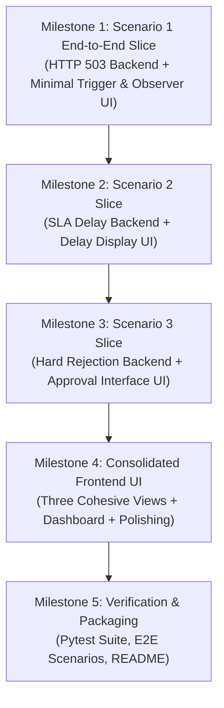

# Implementation Plan Document
## OrderFlow Sentinel — AI-Powered Self-Healing Order Failure Detection and Resolution Platform

---

### Document Control
- **Document Version:** 1.2.1 (Scope Freeze Baseline with Lifecycle, Approval & Type Harmonization)
- **Status:** Approved for Implementation Planning
- **Author:** Lead Solutions Architect & Senior Forward Deployed Engineer
- **Architecture Model:** Modular Monolith with Simulated Downstream Services and Optional Gemini Integration
- **Context:** Virtusa Jatayu Forward Deployed Engineer Hackathon

---

## 1. Incremental Vertical-Slice Delivery Strategy

Rather than a risky horizontal waterfall that defers frontend integration to the end, OrderFlow Sentinel follows an **Incremental Vertical-Slice Delivery Strategy with Early Frontend Integration**. 

Every scenario milestone delivers a complete, testable slice spanning both backend logic and UI visibility:

---

## 2. Milestone Breakdown & Deliverables

### Milestone 1: Scenario 1 End-to-End Vertical Slice (HTTP 503 Self-Healing + Minimal UI)
- **Backend Deliverables:**
  - `backend/app/core/config.py`: Environment configuration loader (`GEMINI_API_KEY`, `GEMINI_MODEL_ID` verified at runtime, SQLite parameters).
  - `backend/app/db/session.py` & `base.py`: SQLite engine with WAL mode and foreign key enforcement.
  - `backend/app/models/`: SQLAlchemy 2.0 ORM models for all 8 entities (`orders`, `order_events`, `incidents`, `rca_reports`, `resolution_actions`, `operator_approvals`, `audit_logs`, `system_policies`). JSON attributes stored consistently as `Column(Text)` containing serialized JSON strings.
  - `backend/app/schemas/`: Pydantic v2 schemas for orders, events, incidents, RCA, resolutions, and simulation.
  - `backend/app/services/simulator.py`: Simulated service adapters for the 7 stages, including transient HTTP 503 injection at Inventory.
  - `backend/app/services/order_service.py`: Order lifecycle manager and multi-hop journey orchestrator. Enforces that orders remain in `PROCESSING` during recoverable failure investigation.
  - `backend/app/services/detector.py`: Deterministic HTTP 503 error detector.
  - `backend/app/ai/gemini_rca.py`: Structured Gemini RCA agent (`evidence_strength`, `corroborating_signals_count`, `explanation`) with internal deterministic fallback.
  - `backend/app/policies/policy_engine.py`: Policy-as-code rule authorizer enforcing retry caps (`max_retries = 3` after initial failure: `attempt_number` strictly 1, 2, 3; no 4th retry) and risk classification.
  - `backend/app/services/resolution_service.py`: Exponential backoff executor with primary database `UNIQUE` constraint idempotency (same key/action returns cached result; conflicting action returns 409) and downstream state verification probe.
  - `backend/app/services/audit_service.py`: Application-level append-only audit logger.
  - `backend/app/api/v1/`: FastAPI routers for `/orders`, `/events`, `/incidents`, `/rca`, `/resolutions`, `/simulation`, and `/health`.
- **Frontend Deliverables (Early Integration):**
  - Minimal React + Vite + Tailwind shell with persistent simulation controls.
  - Basic order inspector view allowing the evaluator to trigger Scenario 1 and watch:
    - Order creation $\rightarrow$ Injected 503 failure at Inventory.
    - Incident flagged $\rightarrow$ Order remains in `PROCESSING` (stage blocked).
    - Advisory RCA generated $\rightarrow$ Automated idempotent retry executed with backoff.
    - State verification assertion passed $\rightarrow$ Incident marked `RESOLVED`.
    - Order continues journey across Fulfilment, Delivery, Notification $\rightarrow$ Order marked `COMPLETED`.
- **Required Tests:**
  - `test_detector_http_503`: Verifies 503 creates an incident while order remains `PROCESSING`.
  - `test_rca_fallback`: Verifies deterministic fallback produces identical valid schema when Gemini is offline.
  - `test_idempotency_behavior`: Verifies same key returns cached result; conflicting action returns 409.
  - `test_retry_cap_enforcement`: Asserts no 4th retry is permitted (`max_retries = 3`).
  - `test_scenario_1_full_loop`: Integration test executing the complete 503 self-healing workflow.
- **Completion Criteria:** Scenario 1 executes end-to-end through both FastAPI Swagger UI and the minimal frontend view.

---

### Milestone 2: Scenario 2 Slice (SLA Delay Detection & UI Display)
- **Backend Deliverables:**
  - `backend/app/services/simulator.py`: Fulfilment latency injector ($10,000\text{ms}$).
  - `backend/app/services/detector.py`: Stage SLA evaluator comparing elapsed time against illustrative demo SLA thresholds ($5,000\text{ms}$ for fulfilment).
  - `backend/app/services/order_service.py`: Order status transition to `DELAYED`.
  - `backend/app/policies/policy_engine.py`: Policy strictly prohibiting auto-cancellation or reassignment.
  - `backend/app/services/audit_service.py`: Application-level append-only audit logging of delay incidents.
- **Frontend Deliverables:**
  - Extend the frontend to display the delay incident.
  - Render SLA delay badge, stage latency comparison against illustrative demo threshold ($10,000\text{ms}$ vs $5,000\text{ms}$ SLA), and operator warning banner without destructive action buttons.
- **Required Tests:**
  - `test_sla_evaluator_breach`: Confirms duration $> \text{SLA}$ flags breach.
  - `test_sla_evaluator_normal`: Confirms normal execution does not flag breach.
  - `test_scenario_2_delay_alert`: Integration test confirming alert generation and zero auto-cancellation.
- **Completion Criteria:** Scenario 2 triggerable from UI; delay incident and alert rendered cleanly with clear timing metrics.

---

### Milestone 3: Scenario 3 Slice (Hard Business Rejection, HITL & Approval UI)
- **Backend Deliverables:**
  - `backend/app/services/simulator.py`: Inventory out-of-stock rejection injector (HTTP 422). Adapter implements parameter validation for substitute SKU and alternate warehouse hub.
  - `backend/app/services/detector.py`: Business rejection classifier. Order remains `PROCESSING` (stage blocked).
  - `backend/app/policies/policy_engine.py`: Policy rule prohibiting auto-retries on business rejections and requiring human approval.
  - `backend/app/services/approval_service.py`: Operator approval workflow coordinator handling `APPROVED` and `REJECTED` decisions with `selected_action` and `action_parameters`. (Override excluded from MVP).
  - `backend/app/api/v1/approvals.py`: Approval queue endpoints.
  - `backend/app/services/resolution_service.py`: Executor dispatching operator-approved actions to the service adapter.
- **Frontend Deliverables:**
  - Extend the frontend with a dedicated Human Approval Queue interface.
  - Display pending approval card showing out-of-stock failure, RCA evidence, risk badge (`HIGH`), substitute parameter inputs, and operator action buttons (`Approve`, `Reject`).
  - Upon operator approval, trigger downstream execution, assert verification, observe order continuing in `PROCESSING`, finishing remaining stages, and transitioning to `COMPLETED`. If rejected, order transitions to `FAILED`.
- **Required Tests:**
  - `test_policy_blocks_hard_rejection_auto_retry`: Asserts auto-retry is forbidden.
  - `test_operator_approval_validation_and_verify`: Verifies adapter parameter validation and state assertion.
  - `test_operator_rejection_fails_order`: Verifies operator rejection transitions order to `FAILED`.
  - `test_scenario_3_hitl_loop`: Integration test for complete Scenario 3 workflow.
- **Completion Criteria:** Scenario 3 requires human decision before order can progress; verification assertion required before resumption; full audit entry created.

---

### Milestone 4: Consolidated Frontend UI & Dashboard Polish
- **Frontend Deliverables:**
  - Complete the **Three Cohesive Views** with near-real-time 3-second polling:
    1. **Dashboard & Monitoring View:** Summary KPI cards (Total Orders, Completed, Failed, Delayed, Pending Approvals), failure distribution chart, and live order monitoring grid.
    2. **Order Journey & Incident RCA View:** Chronological 7-stage interactive timeline visualizer, telemetry event drawer, and Gemini/Fallback RCA diagnostic card showing evidence strength and corroborating signals.
    3. **Human Approval Queue & Audit Trail View:** Pending operator review queue and queryable application-level append-only audit trail table.
    4. **Persistent Simulation Header/Drawer:** Persistent controls allowing one-click execution of Scenario 1 (HTTP 503 self-heal), Scenario 2 (SLA Delay), and Scenario 3 (Hard Rejection).
  - Enterprise styling: Deep navy sidebar (`#0F172A`), crisp gray-white canvas (`#F8FAFC`), blue actions (`#2563EB`), red alerts (`#EF4444`), amber warnings (`#F59E0B`), and emerald green recovery indicators (`#10B981`).
- **Required Tests:**
  - Frontend TypeScript compile & build verification (`npm run build`).
  - API client error handling and fallback display.
- **Completion Criteria:** All three scenarios demonstrably triggerable and observable directly through the browser UI.

---

### Milestone 5: Verification, Packaging & Demonstration Polish
- **Objective:** Finalize test coverage, documentation, and hackathon demonstration readiness.
- **Deliverables:**
  - Unified Pytest test suite covering all services, policies, and scenarios.
  - `README.md` containing architecture diagrams, setup instructions, API overview, and scenario demonstration scripts.
  - `.env.example` documenting `GEMINI_API_KEY` (optional) and `GEMINI_MODEL_ID`.
  - Clean reproducible run scripts.
- **Completion Criteria:**
  - All automated tests pass (`pytest tests/ -v`).
  - Zero terminal errors on clean clone.
  - Flawless demonstration of Scenarios 1, 2, and 3.

---

## 3. Risk Assessment & Mitigations

| Identified Risk | Severity | Engineered Mitigation |
| :--- | :---: | :--- |
| **Gemini API Outage / Missing Key** | High | Deterministic Fallback RCA Engine generates identical structured JSON schema; `/health` endpoint treats Gemini as optional. |
| **Race Conditions / Duplicate Retries** | High | Database `UNIQUE` constraint on `idempotency_key` acts as primary authority; in-memory lock provides single-process protection. |
| **Premature Order Recovery** | High | Verification probe asserts downstream HTTP 200 and state progression before order resumes `PROCESSING`. |
| **UI State Staleness** | Medium | Periodic near-real-time polling (3s) and manual refresh triggers ensure UI stays synchronized with backend database state. |

---

## 4. Acceptance Sign-Off Checklist
- [x] Documentation Phase Completed:
  - `MVP_SCOPE.md` updated with lifecycle, approval contract, retry definitions, and type harmonization.
  - `DOCUMENT_CHANGELOG.md` updated.
  - `PRD.md` updated.
  - `SYSTEM_ARCHITECTURE.md` updated.
  - `DATABASE_SCHEMA.md` updated.
  - `API_SPECIFICATION.md` updated.
  - `IMPLEMENTATION_PLAN.md` updated.
- [ ] User Review and Authorization to begin Phase 2 (Milestone 1).

---
*End of IMPLEMENTATION_PLAN.md*
