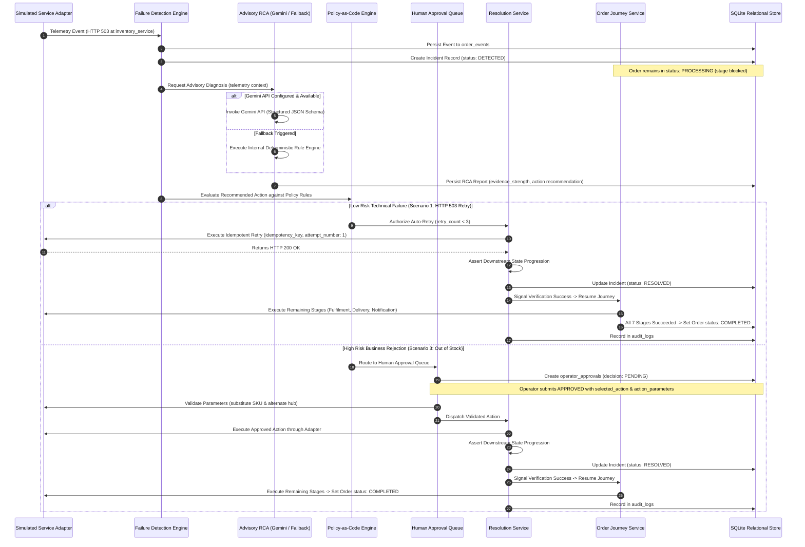
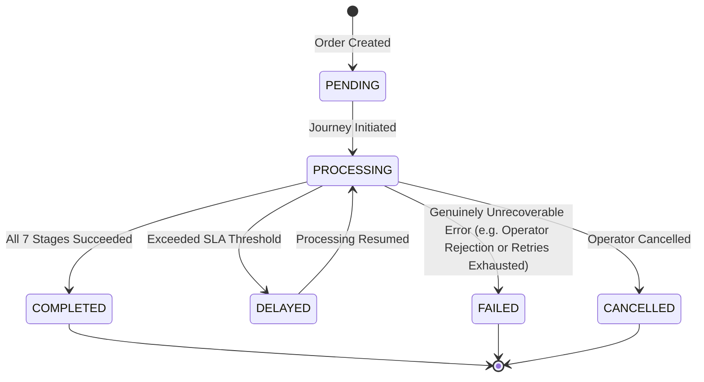
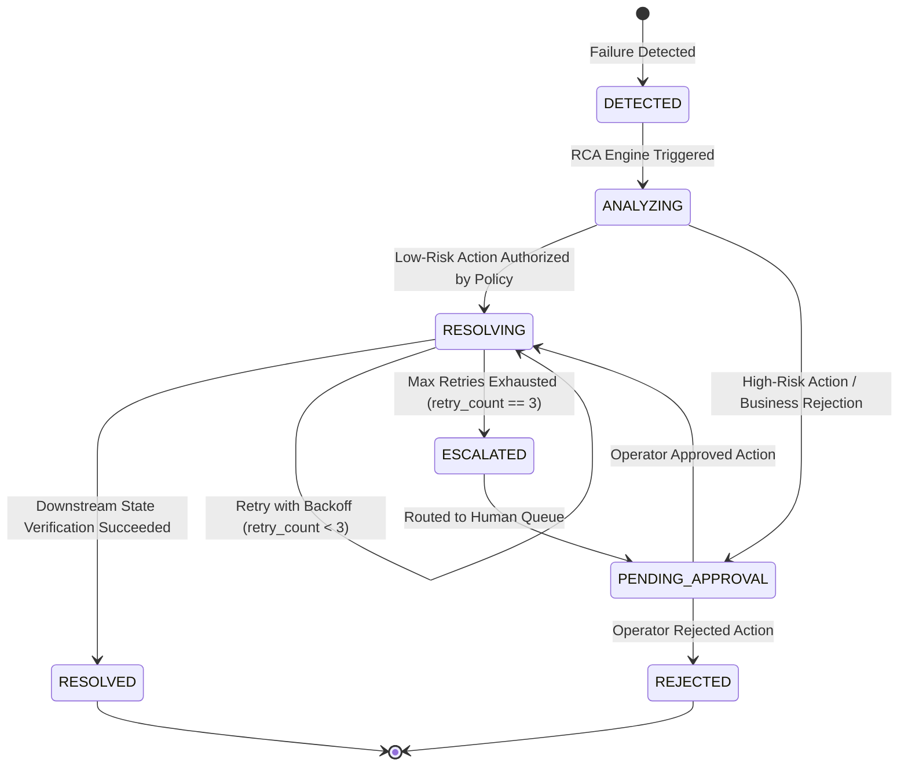

# System Architecture Document
## OrderFlow Sentinel — AI-Powered Self-Healing Order Failure Detection and Resolution Platform

---

### Document Control
- **Document Version:** 1.2.1 (Scope Freeze Baseline with Lifecycle, Approval & Type Harmonization)
- **Status:** Approved for Implementation Planning
- **Author:** Lead Solutions Architect & Forward Deployed Engineer
- **Architecture Model:** Modular Monolith with Simulated Downstream Services and Optional Gemini Integration
- **Context:** Virtusa Jatayu Forward Deployed Engineer Hackathon

---

## 1. High-Level Architecture Overview

OrderFlow Sentinel is structured as a **Modular Monolith with Simulated Downstream Services and Optional Gemini Integration**. It provides near-real-time failure detection, evidence-grounded root cause analysis, deterministic policy gating, and verified self-healing recovery within a single, cohesive, self-contained Python application.

```mermaid
flowchart TD
    subgraph UI_Layer ["Presentation Layer (React 18 + Vite + Tailwind CSS + Lucide + Recharts)"]
        UI_View1["1. Dashboard & Monitoring View (Near-Real-Time 3s Polling)"]
        UI_View2["2. Order Journey & Incident RCA View"]
        UI_View3["3. Human Approval Queue & Audit Trail View"]
        UI_Sim["Persistent Simulation Control Header/Drawer"]
    end

    subgraph API_Gateway ["FastAPI Gateway & Route Controllers (Port 8000)"]
        R_Orders["/api/v1/orders"]
        R_Events["/api/v1/events"]
        R_Incidents["/api/v1/incidents"]
        R_RCA["/api/v1/rca"]
        R_Resolution["/api/v1/resolutions"]
        R_Approvals["/api/v1/approvals"]
        R_Simulation["/api/v1/simulation"]
        R_Analytics["/api/v1/analytics"]
        R_Settings["/api/v1/settings"]
        R_Health["/api/v1/health"]
    end

    subgraph Core_Services ["In-Process Modular Monolith Services"]
        S_Order["Order Service (Lifecycle & Journey Driver)"]
        S_Detector["Failure Detection Engine (Deterministic Rules & SLA Evaluator)"]
        S_RCA["RCA Service (Advisory Gemini Agent + Deterministic Fallback)"]
        S_Policy["Policy-as-Code Engine (Risk Tiers & Retry Limits)"]
        S_Resolution["Resolution Service (Idempotent Retry & State Verification)"]
        S_Approval["Approval Service (Human-in-the-Loop Workflow)"]
        S_Audit["Audit Service (Append-Only Event Logger)"]
    end

    subgraph Service_Adapters ["In-Process Simulated Downstream Services"]
        A_Addr["Address Validation Adapter"]
        A_Pay["Payment Gateway Adapter"]
        A_Inv["Inventory Reservation Adapter"]
        A_Ful["Warehouse Fulfilment Adapter"]
        A_Log["Logistics Dispatch Adapter"]
        A_Not["Customer Notification Adapter"]
    end

    subgraph Persistence_Layer ["Relational Database (SQLAlchemy 2.0 ORM + SQLite)"]
        DB_Orders[(orders)]
        DB_Events[(order_events)]
        DB_Incidents[(incidents)]
        DB_RCA[(rca_reports)]
        DB_Resolutions[(resolution_actions)]
        DB_Approvals[(operator_approvals)]
        DB_Audit[(audit_logs)]
        DB_Config[(system_policies)]
    end

    UI_Layer <-->|REST API / JSON (3s Polling)| API_Gateway
    API_Gateway --> Core_Services
    Core_Services --> Service_Adapters
    Service_Adapters -->|Telemetry Events| Core_Services
    Core_Services --> Persistence_Layer
```

---

## 2. Core Architectural Planes & Components

### 2.1 Presentation Layer (Frontend)
- **Framework:** React 18, TypeScript, Vite, Tailwind CSS, Lucide icons, and Recharts.
- **Near-Real-Time Monitoring:** Employs 3-second polling to maintain synchronization with backend database state.
- **Three Cohesive Views:**
  1. **Dashboard & Monitoring View:** High-level metrics, failure distribution, and order monitoring table.
  2. **Order Journey & Incident RCA View:** Chronological 7-stage interactive timeline visualizer, telemetry event inspector, and Gemini/Fallback RCA diagnostic card showing evidence strength and corroborating signals.
  3. **Human Approval Queue & Audit Trail View:** Operator approval inbox with Approve/Reject decision actions (`APPROVE`, `REJECT`), and queryable append-only audit trail table.
  4. **Persistent Simulation Header/Drawer:** Persistent controls allowing one-click execution of Scenario 1 (HTTP 503 self-heal), Scenario 2 (SLA Delay), and Scenario 3 (Hard Rejection).

### 2.2 API Gateway & Control Plane (Backend)
- **Framework:** FastAPI with Python 3.10+.
- **Design:** Clean modular monolith structured into domains: Routers $\rightarrow$ Services $\rightarrow$ Policies $\rightarrow$ Repositories $\rightarrow$ Models.
- **Validation:** Strict Pydantic v2 schemas for all inputs and outputs.
- **Health & Readiness:** `/health` endpoint checks SQLite database connectivity and schema readiness. Gemini connectivity is reported as an optional dependency; missing credentials do not degrade application health.

### 2.3 Failure Detection Engine
- **Deterministic Detection Scope:** Fully implemented for the three target scenarios:
  1. HTTP 503 transient inventory failure.
  2. Fulfilment SLA delay.
  3. HTTP 422 out-of-stock business rejection.
- **Stage SLA Evaluator:** Compares stage execution duration against illustrative demo thresholds configured in `system_policies`. Flags orders as `DELAYED` without executing destructive auto-actions.
- **Incident Dispatcher:** creates a persistent incident record linked to the order, with lifecycle status transitions managed by the incident service. The order remains `PROCESSING` while the stage is investigated.

### 2.4 Advisory AI Root Cause Analysis Plane
- **Advisory Only (Zero Privileged Mutations):** The RCA agent produces structured explanations and candidate action recommendations. It possesses zero permissions to modify order states or trigger mutations.
- **Evidence-Grounded Prompting:** Gemini synthesizes ingested telemetry logs, HTTP statuses, and timestamps. Chain-of-thought is excluded; the output provides a concise, evidence-grounded explanation.
- **Evidence Strength Rating:** Diagnostic certainty is represented as `evidence_strength` (`HIGH`, `MEDIUM`, `LOW`) accompanied by an integer `corroborating_signals_count`. LLM-generated values are never treated as calibrated probabilities.
- **Configurable Model Runtime:** The model identifier is injected via `GEMINI_MODEL_ID` and verified at runtime. No permanent hardcoded model string is embedded; API keys are never exposed.
- **Deterministic Fallback Engine:** If `GEMINI_API_KEY` is not provided, the API quota is exhausted, or a network fault occurs, an internal deterministic rule engine generates an identical structured diagnosis based on exact error codes.



### 2.5 Policy-as-Code, Retry Policy & Idempotency Governance
- **Policy Engine Authority:** The deterministic policy engine serves as the absolute boundary between advisory recommendations and system mutations.
- **Standardized Retry Semantics:**
  - Maximum retry attempts: `max_retries = 3` after the initial failed request.
  - Initial failed request: `retry_count = 0`.
  - Retry 1: `retry_count = 1` (`attempt_number = 1`).
  - Retry 2: `retry_count = 2` (`attempt_number = 2`).
  - Retry 3: `retry_count = 3` (`attempt_number = 3`).
  - Further retries are strictly prohibited.
  - If verification fails after 3 retries, incident transitions to `ESCALATED`.
  - `attempt_number` in `resolution_actions` strictly denotes retry execution numbers (1, 2, 3), not total requests.
- **Primary Idempotency Guarantee & Response Behavior:**
  - Relational database `UNIQUE` constraints on `resolution_actions.idempotency_key` combined with transaction-safe checks ensure no recovery action can be executed twice.
  - **Repeated Request (Same Key & Same Action):** Returns the existing action record and execution result (HTTP 200) without executing again.
  - **Conflicting Request (Same Key & Different Action / Payload):** Rejects the request and returns HTTP 409 Conflict.
  - An in-memory lock serves as a secondary single-process concurrency safeguard against rapid clicks.

### 2.6 Closed-Loop Verification Engine & Journey Continuation
- Recovery is **never declared successful** merely because an action or retry was dispatched.
- Following action execution:
  1. The resolution executor checks the immediate response (must return HTTP 200).
  2. A verification probe asserts downstream domain state (e.g., inventory reservation confirmed).
  3. Upon successful verification:
     - Incident is transitioned to `RESOLVED`.
     - Order continues in `PROCESSING`.
     - Remaining order journey stages proceed to execution (`FULFILMENT` $\longrightarrow$ `DELIVERY` $\longrightarrow$ `NOTIFICATION`).
     - Order transitions to `COMPLETED` **only after all 7 stages succeed**.
  4. If verification fails and retries remain (`retry_count < 3`), the backoff schedule increments; if retries are exhausted (`retry_count == 3`), the incident is transitioned to `ESCALATED`.

---

## 3. Downstream Simulated Services (The 7 Stages)

The multi-system journey is simulated via six modular in-process adapters:
1. **Address Validation Adapter (`address_service`):** Simulates address verification.
2. **Payment Gateway Adapter (`payment_service`):** Simulates payment authorization and capture.
3. **Inventory Reservation Adapter (`inventory_service`):** Simulates stock reservation; injects transient 503 errors (Scenario 1) or out-of-stock rejections (Scenario 3). Validates `action_parameters` for inventory substitutions.
4. **Warehouse Fulfilment Adapter (`fulfilment_service`):** Simulates order packaging; injects $10,000\text{ms}$ execution latency (Scenario 2).
5. **Logistics Dispatch Adapter (`logistics_service`):** Simulates carrier manifest creation and waybill assignment.
6. **Customer Notification Adapter (`notification_service`):** Simulates confirmation dispatch.

---

## 4. State Machine Models

### 4.1 Order Lifecycle State Machine

*(Note: Orders remain in `PROCESSING` during recoverable failure investigation. There is no transition from `FAILED` back to `PROCESSING`.)*

### 4.2 Incident & Resolution Lifecycle State Machine


---

## 5. Security & Operational Guardrails

1. **Secret Isolation:** `GEMINI_API_KEY` is loaded through environment variables and never returned in API payloads or client bundles.
2. **Deterministic Fallback Assurance:** Application startup does not fail if `GEMINI_API_KEY` is absent; the application automatically activates the deterministic rule engine.
3. **Synthetic PII:** All customer names, emails, addresses, and payment tokens are synthetically generated.
4. **Application-Level Append-Only Audit Logging:** Audit records cannot be modified or deleted through the application's exposed API.
5. **Data Portability:** SQLAlchemy reduces database migration effort, but database-specific behavior and queries may require adjustments if migrating to PostgreSQL.

---
*End of SYSTEM_ARCHITECTURE.md*
