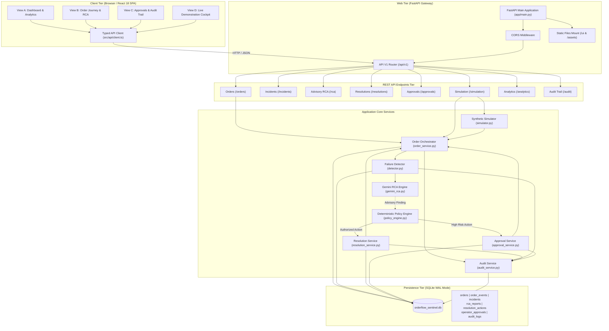
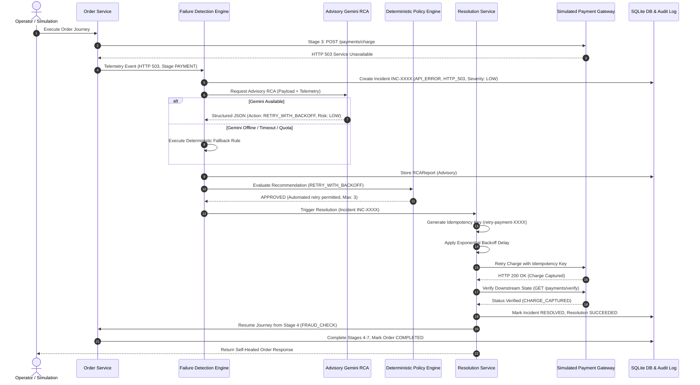
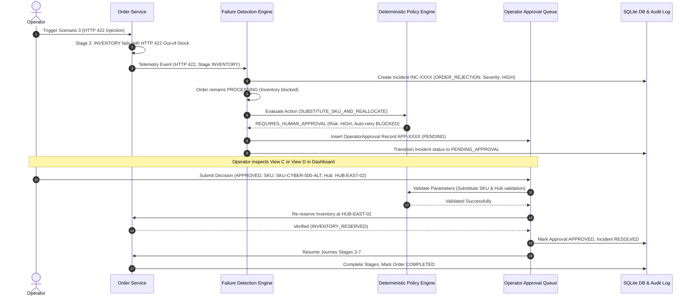
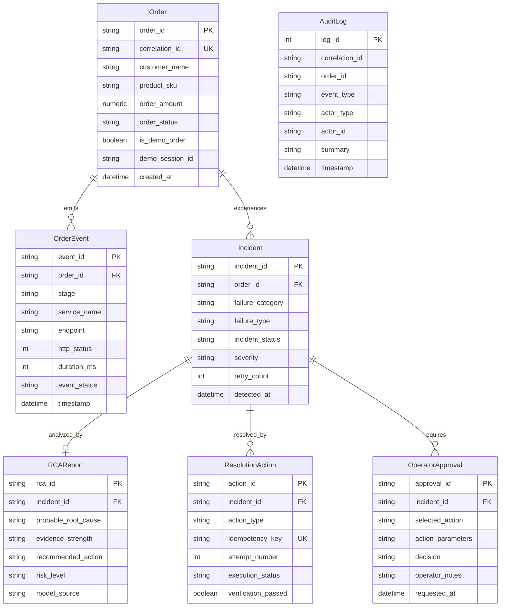
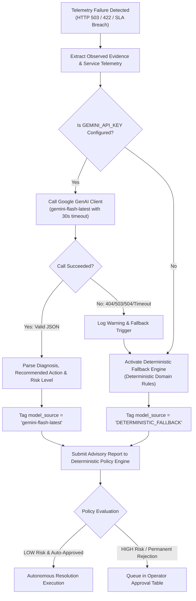

# OrderFlow Sentinel — Complete Architecture & Data Flow Guide

> **Target Version**: 1.2.1-live-demo  
> **Platform**: FastAPI + SQLAlchemy + SQLite (WAL Mode) + React 18 (Vite + TypeScript)  
> **Purpose**: A comprehensive technical breakdown of OrderFlow Sentinel's multi-tier architecture, state machines, self-healing lifecycle, and AI integration.

---

## 1. System Overview & Architectural Principles

OrderFlow Sentinel is designed as a **resilient, policy-governed self-healing order processing platform**. Unlike standard e-commerce platforms where a transient microservice failure or inventory mismatch results in an immediate order drop or hard crash, Sentinel detects failures in flight, consults an advisory AI root-cause analyzer, and applies deterministic, policy-approved recovery actions.

### Core Architectural Safeguards:
1. **Advisory AI Boundary**: Google Gemini is strictly **advisory**. It analyzes telemetry and recommends actions, but possesses **zero execution authority**.
2. **Deterministic Policy Gate**: All recovery recommendations must pass through the authoritative `PolicyEngine` before any mutation is applied.
3. **Idempotency & Concurrency Guards**: Every automated retry receives a cryptographically unique idempotency key to prevent double charging or duplicate fulfilment.
4. **Downstream State Verification**: No order is marked recovered until the downstream service explicitly confirms the valid business state (e.g., verifying `CHARGE_CAPTURED` or `INVENTORY_RESERVED`).
5. **Zero Data Loss & Demo Isolation**: Historical records are strictly segregated from live demonstration orders.

---

## 2. Mermaid Diagrams & Step-by-Step Walkthroughs

### Diagram 1: High-Level Frontend-to-Backend Architecture

#### Step-by-Step Flow:
1. The operator navigates the React SPA (View A, B, C, or D).
2. The typed API client executes REST calls against `/api/v1/...` endpoints.
3. The FastAPI router validates payloads with Pydantic schemas and injects a transactional SQLAlchemy database session.
4. Core services process orders, detect anomalies, consult AI advisory models, and record all events in the SQLite database and audit log.

---

### Diagram 2: Order Processing Flow (7 Sequential Journey Stages)

```mermaid
flowchart LR
    S1["1. VALIDATION<br/>(Format & Schema Check)"] --> S2["2. INVENTORY<br/>(Stock Reservation)"]
    S2 --> S3["3. PAYMENT<br/>(Payment Gateway Charge)"]
    S3 --> S4["4. FRAUD_CHECK<br/>(Risk Scoring Engine)"]
    S4 --> S5["5. FULFILMENT<br/>(Warehouse Packing)"]
    S5 --> S6["6. DELIVERY<br/>(Carrier Dispatch)"]
    S6 --> S7["7. NOTIFICATION<br/>(Customer SMS / Email)"]

    style S1 fill:#10b981,stroke:#047857,color:#ffffff
    style S2 fill:#10b981,stroke:#047857,color:#ffffff
    style S3 fill:#10b981,stroke:#047857,color:#ffffff
    style S4 fill:#10b981,stroke:#047857,color:#ffffff
    style S5 fill:#10b981,stroke:#047857,color:#ffffff
    style S6 fill:#10b981,stroke:#047857,color:#ffffff
    style S7 fill:#10b981,stroke:#047857,color:#ffffff
```

#### Step-by-Step Order Journey:
1. **Stage 1 (VALIDATION)**: Validates SKU formats, pricing, customer details, and shipping address.
2. **Stage 2 (INVENTORY)**: Calls `inventory_service` to reserve stock. (Scenario 3 injects HTTP 422 here).
3. **Stage 3 (PAYMENT)**: Authorizes and captures credit card payment via `payment_service`. (Scenario 1 injects HTTP 503 here).
4. **Stage 4 (FRAUD_CHECK)**: Evaluates transaction velocity, geo-IP, and behavioral risk via `fraud_service`.
5. **Stage 5 (FULFILMENT)**: Dispatches pick-and-pack instruction to warehouse. (Scenario 2 injects latency SLA breach here).
6. **Stage 6 (DELIVERY)**: Integrates with logistics carrier for tracking assignment via `delivery_service`.
7. **Stage 7 (NOTIFICATION)**: Dispatches customer confirmation email/SMS via `notification_service`.
8. Once all 7 stages complete, the order status transitions from `PROCESSING` to **`COMPLETED`**.

---

### Diagram 3: Failure Detection and Self-Healing Flow (Scenario 1: HTTP 503)

---

### Diagram 4: Human-in-the-Loop Approval Workflow (Scenario 3: HTTP 422 Out-of-Stock)

---

### Diagram 5: Database Entity-Relationship Model

---

### Diagram 6: Gemini Advisory Integration & Deterministic Fallback Lifecycle

