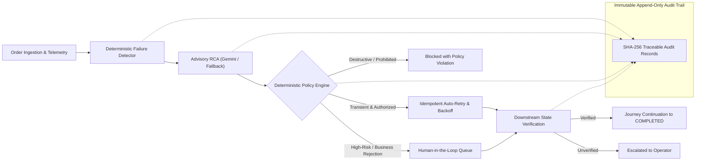
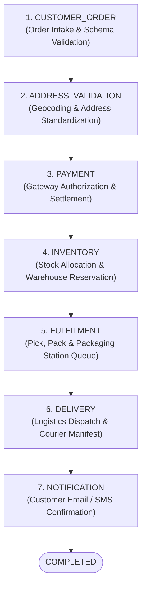
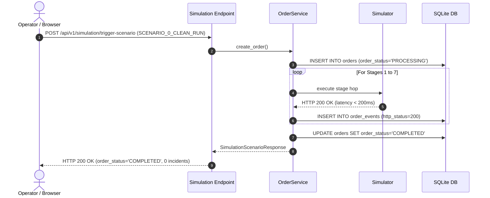
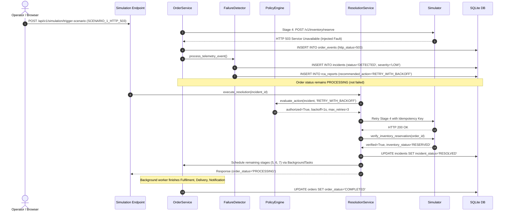
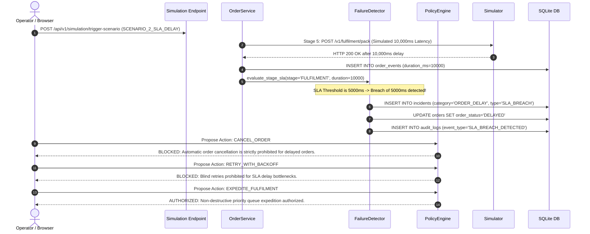
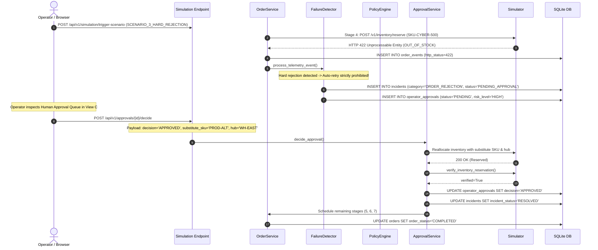
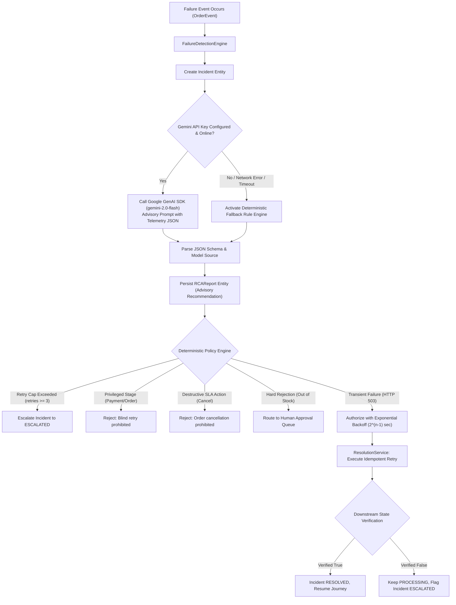

# OrderFlow Sentinel — Project Architecture Guide

**Document Version:** 1.2.1  
**Target Audience:** Forward Deployed Engineers, Solutions Architects, Full-Stack Developers  
**System Classification:** Modular Monolith with Simulated Downstream Logistics and Optional Gemini Advisory AI  
**Repository Root:** `D:\Virtusa Jatayu`  

---

## 1. Executive Summary & Problem Statement

### 1.1 The Business Problem
In enterprise multi-hop e-commerce operations, customer orders traverse a sequence of specialized downstream microservices (e.g., Address Validation, Payment Gateways, Inventory Management Systems, Warehouse Fulfilment Centers, and Logistics Couriers). 

In traditional architectures, failures across these hops present significant operational challenges:
1. **Silent Order Stalls:** Transient downstream outages (such as temporary network timeouts or HTTP 503 database pool exhaustion) cause orders to fail silently or get stuck in indefinite processing states.
2. **Blind & Dangerous Retries:** Automated systems often perform unconstrained "blind retries" against non-idempotent endpoints (such as re-triggering payment captures or duplicating order creation), resulting in double-charges or corrupted state.
3. **Catastrophic Unsafe Actions:** When an order encounters warehouse fulfilment latency, naive automation rules might automatically cancel the order or reassign warehouses even after payments have been settled and physical items picked.
4. **Permanent Failures Treated as Transient:** Hard business rejections (such as physical inventory stockouts with HTTP 422) cannot be resolved by technical retries; retrying them repeatedly wastes compute and risks inventory allocation deadlocks.
5. **Lack of Auditability:** Distributed microservices often lack a unified, tamper-evident audit trail showing exactly *why* a recovery action was selected, *who* authorized it, and *whether* downstream state was verified before declaring recovery.

### 1.2 The Proposed Solution: OrderFlow Sentinel
**OrderFlow Sentinel** is an AI-powered, self-healing order failure detection and resolution platform. It continuously observes order journey telemetry events, detects operational failures deterministically, diagnoses probable root causes using ingested telemetry evidence (via the Google Gemini API or an internal deterministic fallback engine), and executes safety-constrained recovery actions governed strictly by **Policy-as-Code**.

### 1.3 Architectural Model: Modular Monolith
OrderFlow Sentinel is intentionally engineered as a **Modular Monolith with Simulated Downstream Services**, rather than a distributed set of physical microservices:
- **Why a Modular Monolith?** It eliminates network partition anomalies, Docker orchestration overhead, and multi-repository sync issues during demonstration and evaluation, while preserving absolute domain separation within clean Python packages.
- **Simulated Downstream Services:** Downstream logistics endpoints (Payment Gateway, Inventory Reservation, Warehouse Packaging, Courier Delivery, and Notification) are modeled in memory within [`simulator.py`](file:///d:/Virtusa%20Jatayu/backend/app/services/simulator.py), allowing deterministic fault injection (HTTP 503, HTTP 422, SLA latency) with zero external cloud dependencies.
- **AI Advisory Boundary:** The Google Gemini integration is strictly **advisory**. The LLM possesses zero permissions to alter database state or dispatch orders. All state transitions and recovery executions must pass through the deterministic Policy Engine.

---

## 2. End-to-End System Architecture

OrderFlow Sentinel is structured into three cohesive layers: the **Presentation Layer (React Single-Page App)**, the **Application & Domain Layer (FastAPI Modular Monolith)**, and the **Persistence Layer (SQLite in Write-Ahead Logging mode)**.

```mermaid
flowchart TD
    subgraph Presentation ["Presentation Layer (Browser Single-Page App)"]
        UI_A["View A: Operational Dashboard & KPIs"]
        UI_B["View B: 7-Stage Order Journey & RCA"]
        UI_C["View C: Human Approval Queue & Audit Trail"]
        CTRL["Persistent Simulation Control Bar"]
    end

    subgraph API ["REST API Layer (FastAPI v1)"]
        R_ORD["/api/v1/orders"]
        R_INC["/api/v1/incidents"]
        R_RCA["/api/v1/rca"]
        R_RES["/api/v1/resolutions"]
        R_APP["/api/v1/approvals"]
        R_SIM["/api/v1/simulation"]
        R_AUD["/api/v1/audit"]
        R_ANA["/api/v1/analytics"]
    end

    subgraph Domain ["Domain Services & Governance"]
        ORCH["Order Journey Orchestrator (order_service)"]
        DET["Deterministic Failure Detector (detector)"]
        SIM["Downstream Logistics Simulator (simulator)"]
        RCA["Advisory RCA Engine (gemini_rca)"]
        POL["Deterministic Policy-as-Code Engine (policy_engine)"]
        RES["Resolution Orchestrator (resolution_service)"]
        APP["Approval Workflow Manager (approval_service)"]
        AUD["Append-Only Audit Service (audit_service)"]
    end

    subgraph Persistence ["Persistence Layer (SQLite WAL)"]
        DB[("orderflow_sentinel.db")]
        T_ORD[("orders")]
        T_EVT[("order_events")]
        T_INC[("incidents")]
        T_RCA[("rca_reports")]
        T_RES[("resolution_actions")]
        T_APP[("operator_approvals")]
        T_AUD[("audit_logs")]
        T_POL[("system_policies")]
    end

    Presentation <--> API
    API <--> Domain
    Domain <--> Persistence
```

### Architectural Data Flow Explained:
1. **Simulation & Ingestion:** When a scenario is triggered from the UI control bar, the request arrives at `POST /api/v1/simulation/trigger-scenario`.
2. **Order Orchestration:** `order_service` creates the `Order` entity in SQLite and iterates through the seven journey stages using simulated downstream adapters.
3. **Telemetry & Failure Detection:** Every stage hop emits an `OrderEvent` to SQLite. If an HTTP failure or latency SLA breach occurs, `detector.py` immediately creates an `Incident`.
4. **Advisory Diagnosis:** The `rca_engine` compiles the latest 5 telemetry events and prompts Gemini (or the deterministic fallback engine) to generate an advisory root cause narrative.
5. **Policy Authorization:** The candidate action is checked against `policy_engine.py`. If authorized and automated, `resolution_service` executes the action with backoff; if high-risk or permanent rejection, it routes to `approval_service`.
6. **State Verification:** Before declaring recovery, the platform queries the simulator's internal state to ensure the downstream resource is genuinely reserved.
7. **Audit Logging:** Every transition is recorded in `audit_logs` with actor attribution (`SYSTEM`, `AI_AGENT`, `OPERATOR`, `SIMULATOR`).

---

## 3. The 7-Stage Order Journey Lifecycle

Every customer order processed by OrderFlow Sentinel follows a strict, non-reversible 7-stage state machine:

### Stage Transitions and Safety Rules
- **Stage 1 (CUSTOMER_ORDER):** Validates customer identity, email, product SKU, and order total. Status: `PENDING` $\rightarrow$ `PROCESSING`.
- **Stage 2 (ADDRESS_VALIDATION):** Asserts delivery address format and routing zone.
- **Stage 3 (PAYMENT):** Executes non-reentrant payment capture with a unique transaction idempotency key. **Privileged Stage:** Policy strictly prohibits automated retries on payment capture without human verification.
- **Stage 4 (INVENTORY):** Reserves physical stock at regional distribution center. Vulnerable to transient downstream outages (HTTP 503) and permanent out-of-stock rejections (HTTP 422).
- **Stage 5 (FULFILMENT):** Packages items at picking stations. Subject to SLA latency evaluation (threshold default: 5000ms).
- **Stage 6 (DELIVERY):** Generates courier consignment and manifest.
- **Stage 7 (NOTIFICATION):** Transmits delivery tracker to customer. **Milestone Completion:** Only after all 7 stages succeed does the database order status become `COMPLETED`.

---

## 4. Scenario Workflows and State Machines

### 4.1 Scenario 0: Clean Baseline Order Run
Demonstrates the nominal operating path without failures or latency anomalies.

---

### 4.2 Scenario 1: HTTP 503 Inventory Self-Healing

---

### 4.3 Scenario 2: Fulfilment SLA Delay & Operator Alert

---

### 4.4 Scenario 3: Hard Business Rejection (HTTP 422) & Human-in-the-Loop Approval

---

## 5. RCA Engine & Deterministic Policy Decision Flow

---

## 6. Comprehensive Folder & Module Specification

Below is the exhaustive, folder-by-folder architectural catalog of every critical Python module and React component in the repository:

### 6.1 Backend Core & Configuration

#### [`backend/app/core/config.py`](file:///d:/Virtusa%20Jatayu/backend/app/core/config.py)
1. **What it does:** Central application configuration class based on `pydantic-settings`. Loads environment variables from `.env` or system environment.
2. **Why it exists:** Provides strongly typed, verified configuration settings for database paths, server hosts, ports, Gemini model IDs, and API prefixes across the entire backend.
3. **What calls it:** Every service, database session, logging setup, and API router imports `settings`.
4. **Which module it calls next:** Pydantic's `BaseSettings`.
5. **Database tables used:** None.
6. **API endpoint exposing it:** Indirectly exposed via `GET /` (metadata) and `GET /api/v1/health`.

#### [`backend/app/core/logging.py`](file:///d:/Virtusa%20Jatayu/backend/app/core/logging.py)
1. **What it does:** Configures centralized structured logging with timestamps, log levels, and module tags.
2. **Why it exists:** Ensures application-wide log consistency and prevents secrets (e.g. Gemini API keys) from leaking into terminal outputs.
3. **What calls it:** All services, routers, and database modules.
4. **Which module it calls next:** Standard library `logging`.
5. **Database tables used:** None.
6. **API endpoint exposing it:** None (system infrastructure).

---

### 6.2 Database Layer

#### [`backend/app/db/session.py`](file:///d:/Virtusa%20Jatayu/backend/app/db/session.py)
1. **What it does:** Instantiates the SQLAlchemy SQLite engine, binds connection listeners for SQLite PRAGMA foreign keys and Write-Ahead Logging (`WAL`), and provides the `get_db()` dependency generator.
2. **Why it exists:** Provides thread-safe, high-concurrency database access without database lock collisions.
3. **What calls it:** FastAPI dependency injection `Depends(get_db)` in all endpoint files; `init_db()` in `main.py` and test harnesses.
4. **Which module it calls next:** `backend.app.models.order` for metadata registration.
5. **Database tables used:** All 8 tables.
6. **API endpoint exposing it:** `GET /api/v1/health` verifies connectivity via `verify_database_connection()`.

#### [`backend/app/models/order.py`](file:///d:/Virtusa%20Jatayu/backend/app/models/order.py)
1. **What it does:** Declares the 8 SQLAlchemy ORM database models.
2. **Why it exists:** Provides the single source of truth for database schema definitions, primary keys, relationships, cascade behaviors, and indexes.
3. **What calls it:** All domain services, detectors, and endpoint handlers.
4. **Which module it calls next:** SQLAlchemy declarative base.
5. **Database tables declared:** `orders`, `order_events`, `incidents`, `rca_reports`, `resolution_actions`, `operator_approvals`, `audit_logs`, `system_policies`.
6. **API endpoint exposing it:** All endpoints serialize these models into Pydantic response schemas.

---

### 6.3 Domain Services & Intelligence

#### [`backend/app/policies/policy_engine.py`](file:///d:/Virtusa%20Jatayu/backend/app/policies/policy_engine.py)
1. **What it does:** Implements the deterministic Policy-as-Code engine. Evaluates proposed actions against 5 strict safety rules: max 3 retries, payment/order retry guards, exponential backoff computation, SLA destructive action vetoes, and mandatory human gating for hard business rejections.
2. **Why it exists:** Serves as the absolute, non-bypassable boundary separating advisory recommendations from real system mutations.
3. **What calls it:** `resolution_service.py`, `approval_service.py`, and `POST /api/v1/resolutions/authorize`.
4. **Which module it calls next:** None (pure functional evaluation).
5. **Database tables used:** Reads `Incident` attributes.
6. **API endpoint exposing it:** `POST /api/v1/resolutions/authorize`.

#### [`backend/app/ai/gemini_rca.py`](file:///d:/Virtusa%20Jatayu/backend/app/ai/gemini_rca.py)
1. **What it does:** Generates advisory Root Cause Analysis reports. Calls Google GenAI SDK (`gemini-2.0-flash`) when configured; otherwise falls back seamlessly to an internal deterministic rule engine.
2. **Why it exists:** Delivers evidence-grounded incident explanations with confidence levels and recommended actions without coupling system stability to external AI uptime.
3. **What calls it:** `POST /api/v1/rca/{incident_id}/analyze` and `detector.py`.
4. **Which module it calls next:** `google.genai` SDK when enabled, or local fallback rules.
5. **Database tables used:** None directly (returns dictionary to calling service).
6. **API endpoint exposing it:** `POST /api/v1/rca/{incident_id}/analyze`.

#### [`backend/app/services/simulator.py`](file:///d:/Virtusa%20Jatayu/backend/app/services/simulator.py)
1. **What it does:** Simulates all 7 downstream logistics microservices with realistic latencies, fault injection hooks, and downstream reservation verification stores.
2. **Why it exists:** Enables end-to-end demonstrations of complex distributed failure scenarios and idempotent state verifications without requiring external cloud accounts or live carrier APIs.
3. **What calls it:** `order_service.py`, `resolution_service.py`, and `approval_service.py`.
4. **Which module it calls next:** None (in-memory state simulator).
5. **Database tables used:** None.
6. **API endpoint exposing it:** `POST /api/v1/simulation/trigger-scenario`.

#### [`backend/app/services/detector.py`](file:///d:/Virtusa%20Jatayu/backend/app/services/detector.py)
1. **What it does:** Deterministically identifies HTTP 503 transient failures, SLA threshold latency breaches, and HTTP 422 Out-of-Stock rejections. Creates `Incident` and `OperatorApproval` records.
2. **Why it exists:** Automates rapid failure classification and prevents unmonitored stalled orders.
3. **What calls it:** `order_service.py` after recording each stage's telemetry event.
4. **Which module it calls next:** `rca_engine` for initial advisory diagnosis; `audit_service` for incident logging.
5. **Database tables used:** `incidents`, `system_policies`, `operator_approvals`, `orders`.
6. **API endpoint exposing it:** `GET /api/v1/incidents`.

#### [`backend/app/services/order_service.py`](file:///d:/Virtusa%20Jatayu/backend/app/services/order_service.py)
1. **What it does:** Orchestrates the order journey across all 7 stages, manages database transactions, persists telemetry events, executes background stage continuation, and computes chronological stage timelines.
2. **Why it exists:** Acts as the central core order domain manager.
3. **What calls it:** `simulation.py`, `orders.py`, `resolution_service.py`, and `approval_service.py`.
4. **Which module it calls next:** `simulator.py` for execution; `detector.py` for monitoring; `audit_service.py` for audit logging.
5. **Database tables used:** `orders`, `order_events`.
6. **API endpoint exposing it:** `GET /api/v1/orders`, `GET /api/v1/orders/{id}`, `GET /api/v1/orders/{id}/journey`.

#### [`backend/app/services/resolution_service.py`](file:///d:/Virtusa%20Jatayu/backend/app/services/resolution_service.py)
1. **What it does:** Implements self-healing resolution workflows: authorizes proposed actions via PolicyEngine, applies exponential backoff, dispatches idempotent retries, verifies downstream inventory state, and schedules remaining stages via FastAPI background tasks.
2. **Why it exists:** Provides automated, safe, idempotent self-healing without manual human intervention for authorized transient failures.
3. **What calls it:** `POST /api/v1/resolutions/execute` and `simulation.py`.
4. **Which module it calls next:** `policy_engine.py`, `simulator.py`, `order_service.py`, and `audit_service.py`.
5. **Database tables used:** `resolution_actions`, `incidents`, `orders`.
6. **API endpoint exposing it:** `POST /api/v1/resolutions/execute`.

#### [`backend/app/services/approval_service.py`](file:///d:/Virtusa%20Jatayu/backend/app/services/approval_service.py)
1. **What it does:** Manages Human-in-the-Loop workflows for permanent business rejections (Scenario 3). Validates substitute SKU and alternate warehouse hub parameters, executes reallocation, verifies downstream reservation, or executes order rejection.
2. **Why it exists:** Ensures that irreversible, business-critical decisions remain under human operator control.
3. **What calls it:** `POST /api/v1/approvals/{id}/decide` and `simulation.py`.
4. **Which module it calls next:** `simulator.py`, `order_service.py`, and `audit_service.py`.
5. **Database tables used:** `operator_approvals`, `incidents`, `orders`.
6. **API endpoint exposing it:** `GET /api/v1/approvals/pending`, `POST /api/v1/approvals/{id}/decide`.

#### [`backend/app/services/audit_service.py`](file:///d:/Virtusa%20Jatayu/backend/app/services/audit_service.py)
1. **What it does:** Appends immutable audit records into the `audit_logs` table with actor classification, event type, and serialized metadata.
2. **Why it exists:** Guarantees enterprise regulatory compliance and end-to-end traceability of automated and manual decisions. Records cannot be edited or deleted via the API.
3. **What calls it:** All services and API endpoint handlers.
4. **Which module it calls next:** SQLAlchemy database session.
5. **Database tables used:** `audit_logs`.
6. **API endpoint exposing it:** `GET /api/v1/audit`.

---

### 6.4 React Single-Page Application (Frontend)

#### [`frontend/src/App.tsx`](file:///d:/Virtusa%20Jatayu/frontend/src/App.tsx)
1. **What it does:** Root application component. Manages global state (metrics, distribution, orders, active tab, active order, pending approvals, audit logs), 3-second non-overlapping interval polling, and browser history synchronization (`pushState`/`popstate`).
2. **Why it exists:** Connects all UI views into a unified single-page experience.
3. **What calls it:** `main.tsx`.
4. **Which module it calls next:** `api/client.ts`, `ViewA_Dashboard`, `ViewB_JourneyRCA`, `ViewC_ApprovalsAudit`, `Header`, `Navigation`, `SimulationControls`.
5. **Database tables used:** Consumes all tables via REST APIs.
6. **API endpoint exposing it:** Served on `/ui` or Vite port 3000.

#### [`frontend/src/api/client.ts`](file:///d:/Virtusa%20Jatayu/frontend/src/api/client.ts)
1. **What it does:** Type-safe HTTP API client encapsulating all `fetch` requests with error handling (`ApiError`), response envelope unpacking (`data`), and telemetry normalization.
2. **Why it exists:** Decouples UI components from low-level fetch mechanics and API URL strings.
3. **What calls it:** `App.tsx`.
4. **Which module it calls next:** Browser `fetch` API.
5. **Database tables used:** All via backend endpoints.
6. **API endpoint exposing it:** Connects to all `/api/v1/*` endpoints.

#### [`frontend/src/components/views/ViewA_Dashboard.tsx`](file:///d:/Virtusa%20Jatayu/frontend/src/components/views/ViewA_Dashboard.tsx)
1. **What it does:** Operational monitoring dashboard. Renders 6 KPI summary cards, a failure category distribution bar chart (Recharts), and a server-side paginated orders table with search and status filtering.
2. **Why it exists:** Gives operators an immediate high-level health overview of system-wide throughput and failures.
3. **What calls it:** `App.tsx` (when `activeTab === 'dashboard'`).
4. **Which module it calls next:** Sub-components (`Card`, `Badge`, Lucide icons).
5. **Database tables used:** Backed by `orders`, `incidents`, `operator_approvals`.
6. **API endpoint exposing it:** `GET /api/v1/analytics/metrics`, `GET /api/v1/analytics/distribution`, `GET /api/v1/orders`.

#### [`frontend/src/components/views/ViewB_JourneyRCA.tsx`](file:///d:/Virtusa%20Jatayu/frontend/src/components/views/ViewB_JourneyRCA.tsx)
1. **What it does:** Detailed order diagnostics view. Renders the 7-stage chronological order journey timeline with stage duration and HTTP status badges, incident summary card, advisory RCA report with confidence score, and a slide-over raw telemetry log drawer.
2. **Why it exists:** Allows operators to inspect exactly where and why an order failed, review evidence, and track self-healing progression.
3. **What calls it:** `App.tsx` (when `activeTab === 'journey'`).
4. **Which module it calls next:** Sub-components (`Card`, `Badge`, Lucide icons).
5. **Database tables used:** `orders`, `order_events`, `incidents`, `rca_reports`.
6. **API endpoint exposing it:** `GET /api/v1/orders/{id}`, `GET /api/v1/orders/{id}/journey`, `GET /api/v1/incidents?order_id=...`.

#### [`frontend/src/components/views/ViewC_ApprovalsAudit.tsx`](file:///d:/Virtusa%20Jatayu/frontend/src/components/views/ViewC_ApprovalsAudit.tsx)
1. **What it does:** Governance and compliance view. Displays the Human-in-the-Loop approval queue with decision forms (substitute SKU and alternate hub inputs) and the complete immutable application audit trail table with filtering.
2. **Why it exists:** Provides human operators with tools to resolve hard business rejections and auditors with verifiable event logs.
3. **What calls it:** `App.tsx` (when `activeTab === 'approvals'`).
4. **Which module it calls next:** Sub-components (`Card`, `Badge`, Lucide icons).
5. **Database tables used:** `operator_approvals`, `audit_logs`.
6. **API endpoint exposing it:** `GET /api/v1/approvals/pending`, `POST /api/v1/approvals/{id}/decide`, `GET /api/v1/audit`.

---

## 7. Audit & Verification Architecture

OrderFlow Sentinel implements a two-fold trust architecture:
1. **Pre-Recovery State Verification:** The system refuses to mark an order recovered or completed solely based on an HTTP 200 return code from a retry. `resolution_service` and `approval_service` explicitly invoke `simulator.verify_inventory_reservation(order_id)` and verify downstream database integrity before transitioning incident state to `RESOLVED`.
2. **Append-Only Immutable Audit Log:** The `audit_logs` database table contains no update or delete routes in the API. Every administrative decision, AI recommendation, policy evaluation, and operator decision is recorded with an actor tag, correlation ID, and timestamp.

