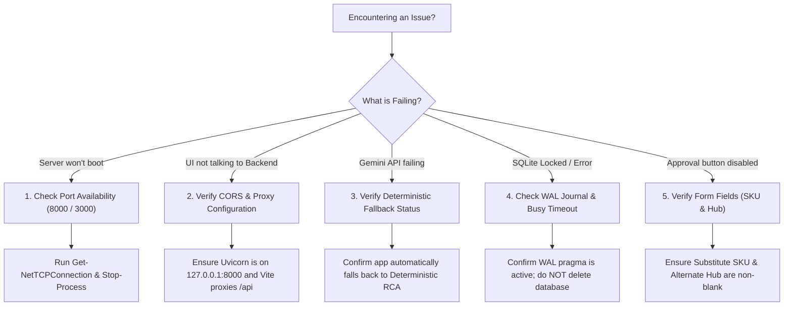

# OrderFlow Sentinel — Troubleshooting & Diagnostics Guide

> **Target Version**: 1.2.1-live-demo  
> **Platform**: Windows 11 (PowerShell)  
> **Diagnostic Command**: `powershell -ExecutionPolicy Bypass -File .\check_environment.ps1`  

---

## 1. Quick Diagnostic Flowchart



---

## 2. Common Problems & Safe Remedies

---

### Problem 1: Port Already in Use (`Errno 10048` / `EADDRINUSE`)
- **Cause**: A previous Uvicorn or Node development server was backgrounded or not stopped with `Ctrl+C`.
- **Diagnosis**:
  ```powershell
  Get-NetTCPConnection -LocalPort 8000 -ErrorAction SilentlyContinue | Select-Object LocalPort, OwningProcess
  Get-NetTCPConnection -LocalPort 3000 -ErrorAction SilentlyContinue | Select-Object LocalPort, OwningProcess
  ```
- **Safe Fix**: Terminate the specific orphan PID:
  ```powershell
  Stop-Process -Id <PID> -Force
  ```

---

### Problem 2: PowerShell Script Execution Policy Error (`PSSecurityException`)
- **Cause**: Windows 11 default PowerShell restricts executing unsigned `.ps1` files (including `npm.ps1` or `Activate.ps1`).
- **Diagnosis**: Terminal outputs: `File ... cannot be loaded because running scripts is disabled on this system.`
- **Safe Fix**: Run commands with bypass policy for the current process:
  ```powershell
  Set-ExecutionPolicy -Scope Process -ExecutionPolicy Bypass
  ```
  Or invoke Node package commands using `npm.cmd` instead of bare `npm`:
  ```powershell
  npm.cmd run build
  ```

---

### Problem 3: SQLite `database is locked`
- **Cause**: Multiple processes attempting concurrent exclusive writes without Write-Ahead Logging (WAL).
- **Diagnosis**: Backend log reports `sqlite3.OperationalError: database is locked`.
- **Safe Fix**:
  1. Confirm WAL mode is active:
     ```powershell
     .\.venv\Scripts\python.exe -c "import sqlite3; conn = sqlite3.connect('orderflow_sentinel.db'); print(conn.cursor().execute('PRAGMA journal_mode').fetchone()[0])"
     ```
     *(Should output `wal`)*.
  2. If locked, ensure no database GUI (e.g., DB Browser for SQLite) has an uncommitted write lock open.
  3. **DO NOT DELETE THE DATABASE FILE**.

---

### Problem 4: Gemini API Errors (503 High Demand, 504 Deadline Exceeded, 404 Deprecated Model)
- **Cause**: Google Cloud service experience spikes, model deprecations (e.g. `gemini-2.0-flash` deprecated in favor of `gemini-flash-latest`), or quota throttling.
- **Diagnosis**: Backend terminal displays:
  ```text
  WARNING: Gemini RCA call failed (503 Service Unavailable). Activating deterministic fallback.
  INFO: Generating RCA via internal deterministic rule engine.
  ```
- **Safe Fix**: **No action required**. OrderFlow Sentinel is specifically engineered to handle external AI failures gracefully. The deterministic fallback engine automatically generates the exact required diagnosis in under 5ms. If you wish to use Gemini, ensure `.env` specifies `GEMINI_MODEL_ID=gemini-flash-latest`.

---

### Problem 5: Frontend Cannot Connect to Backend (Network Error / CORS)
- **Cause**: FastAPI server is not running, or Vite is configured to proxy to the wrong port.
- **Diagnosis**: Browser developer console displays `net::ERR_CONNECTION_REFUSED` on `/api/v1/...`.
- **Safe Fix**:
  1. Verify the backend health endpoint responds:
     ```powershell
     curl http://localhost:8000/api/v1/health
     ```
  2. If running Vite dev server, confirm `frontend/vite.config.ts` has:
     ```typescript
     proxy: { '/api': { target: 'http://127.0.0.1:8000', changeOrigin: true } }
     ```

---

### Problem 6: Approval Submission Fails / Button Disabled
- **Cause**: Attempting to submit an approval with blank `substitute_sku` or blank `alternate_hub`.
- **Diagnosis**: Backend returns `400 Bad Request: Substitute SKU and alternate warehouse hub are required`.
- **Safe Fix**: Ensure both input fields in View C or View D have values (e.g., SKU: `SKU-CYBER-500-ALT`, Hub: `HUB-EAST-02`).

---

### Problem 7: Inspect Journey View (View B) Shows "Order Not Found"
- **Cause**: Navigating to View B without selecting an order, or passing a stale `order_id` in the URL deep-link.
- **Safe Fix**: Navigate back to **Dashboard (View A)** or **Live Order Demonstration (View D)** and click **Inspect Journey** on an active order.

